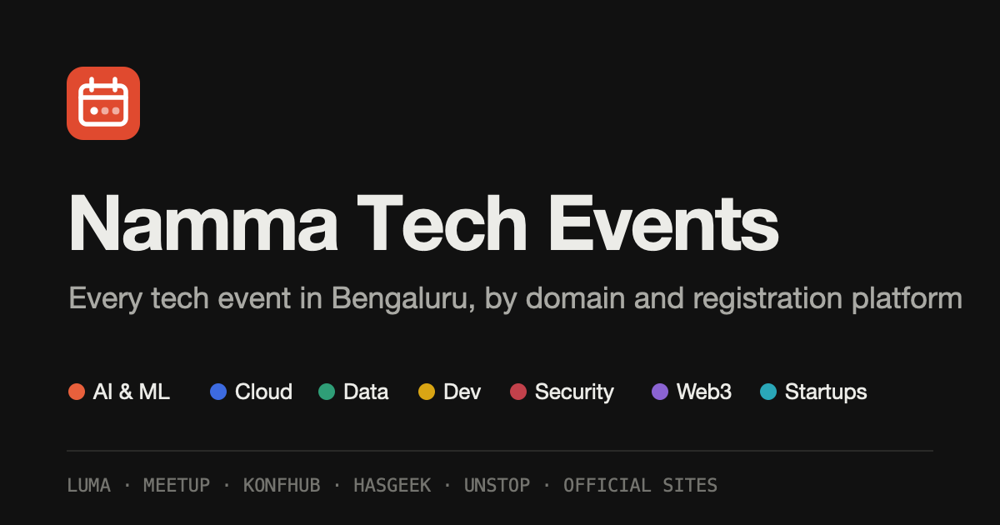

# Namma Tech Events

Every upcoming tech event in Bengaluru in one place, organised by domain and labelled by the platform you register on.

**Live site:** https://saqlainap.github.io/namma-tech-events/



## What it does

- **Discover** – browse events as poster cards or a compact list. Filter by date (today, tomorrow, next 7 / 30 days), domain, registration platform, perks (swag, food, free entry, hands-on, hackathon, prizes) and verified listings only. Sort by date, verification, perks, title, platform or domain.
- **Domains and fields** – AI & ML, Cloud & DevOps, Data, Dev & Web, Security, Web3, Product & Design, Startups, Hardware & IoT and Enterprise, each with sub-field chips (GenAI, Kubernetes, Flutter…).
- **Calendar** – month grid with a coloured dot per event; pick a day to see its line-up.
- **Find an event** – paste a poster caption, LinkedIn post or invite. The page reads the date, time and venue, shows the closest events in the library and everything else on that day, and builds ready-made searches for Luma, Meetup, Konfhub, LinkedIn and Bengaluru listing sites.
- **Event details** – registration link, copy button, Google Calendar link, map link, perks and where the listing was found.
- Day and night themes, phone layout with a slide-up filter sheet.

## Data

Events are collected from registration platforms (Luma, Meetup, Konfhub, HasGeek, Unstop, Eventbrite, Devfolio, Commudle, GDG), Bengaluru listing sites, community calendars, and conference and company event pages. Each event links to its registration page and is marked **Verified** when its date and venue were confirmed on that page, or **To confirm** when they came from a listing site.

Always check the registration page before you go.

### Refresh cadence

Each source in [`data/sources.json`](data/sources.json) has a refresh cadence:

| Cadence | Sources |
|---|---|
| Daily | Luma, Meetup, AllEvents, Unstop and Bengaluru listing sites |
| Weekly | Konfhub, Eventbrite, HasGeek, Devfolio, GDG and community calendars |
| Fortnightly | Conferences, industry listings and company event pages |

A refresh only re-crawls sources whose window has passed:

```bash
python3 data/refresh_plan.py                 # list sources that are due, grouped by crawl slice
python3 data/refresh_plan.py --mark <slice>  # record a slice as fetched today
```

## Project layout

```
index.html            app source (single file; also published as a claude.ai artifact with live web search)
data/crawl/           raw crawl results (JSON)
data/merge.py         dedupes crawl results and injects events + sources into index.html
data/refresh_plan.py  works out which sources are due for a refresh
data/build_site.py    builds the static site into docs/
site-assets/          favicon and social image sources
docs/                 GitHub Pages output (generated)
```

## Build

```bash
python3 data/merge.py        # after adding new files to data/crawl/
python3 data/build_site.py   # writes docs/
python3 -m http.server -d docs 8000
```

No dependencies beyond Python 3.
